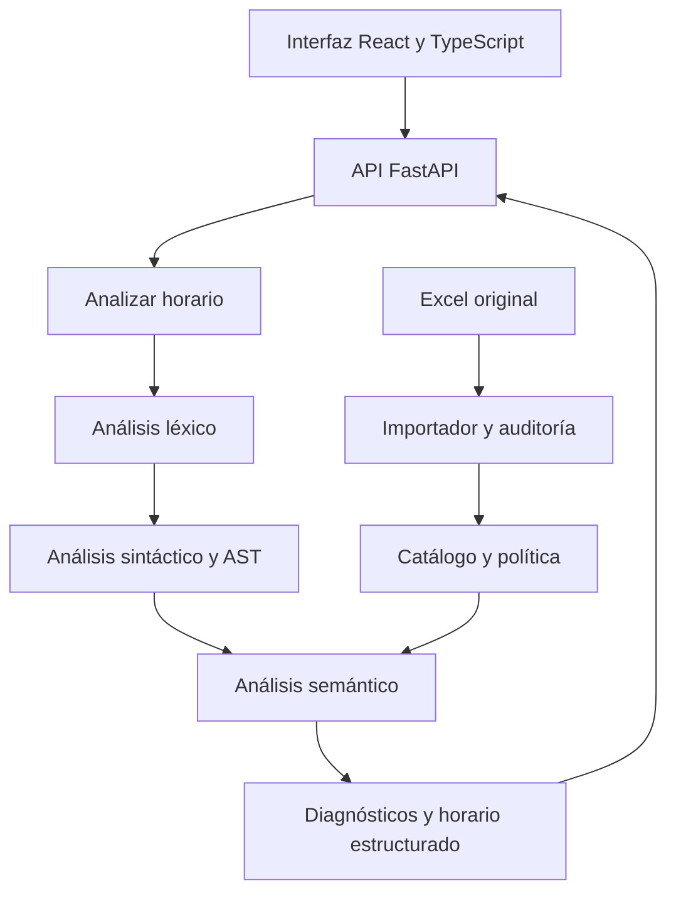

# Arquitectura web y plan propuesto

Estado: etapas 1 a 3 preparadas: estructura, modelos, contrato y lexer. Parser,
semántica e interfaz completa pendientes. Stack confirmado por el usuario.
Sin publicación. Léxico y CLI: [documentación de etapa 3](08-analisis-lexico.md).
El seguimiento vigente de etapas está en [el roadmap](05-roadmap.md).

## Orden de trabajo

Primero se define alcance, datos, lenguaje y reglas. Con esa base se concreta la
arquitectura y el contrato entre frontend y backend. Después se implementa una
porción completa de ejemplo, se añaden reglas y se termina la interfaz.

El análisis de fuentes y la especificación del lenguaje se encuentran en los
otros documentos de esta carpeta. Sus decisiones son revisables; los hechos
extraídos de las fuentes y las propuestas están diferenciados.

## Propuesta técnica

| Componente | Propuesta | Motivo |
| --- | --- | --- |
| Interfaz | React con TypeScript | Editor, tablas, árbol y calendario con contratos de datos tipados |
| API | Python con FastAPI | Adaptar solicitudes HTTP al caso de uso y documentar el contrato |
| Léxico y sintaxis | Gramática propia con Lark | Gramática explícita, tokens, posiciones y árbol observable |
| Semántica | Python propio | Reglas de horarios comprobables y separadas de la gramática |
| Datos iniciales | Archivos estructurados y versionados | Mantener trazabilidad del Excel y facilitar pruebas reproducibles |

Esta selección fue confirmada por el usuario, no es una exigencia de la maestra.
Las dependencias iniciales están declaradas y fijadas en backend y frontend.

`tokenize` pertenece al lenguaje Python: no sirve como definición de nuestro
lenguaje de horarios. Lark permite definir una gramática diferente. Una opción
alternativa, si desean mostrar la implementación manual de los analizadores,
es un lexer por expresiones regulares y un parser descendente recursivo, usando
los mismos contratos del núcleo. La semántica se implementa en ambos casos.

Para Lark se propone un lexer `basic` y parser `lalr`, para poder inspeccionar una
tokenización que no dependa del contexto sintáctico. Se conservarán posiciones y
se transformará el árbol de análisis en un AST propio. La gramática concreta y
las prioridades de tokens deben verificarse antes de adoptar esta configuración.

Pydantic validará la forma del JSON de la API. Las reglas como capacidad u ocupación
de aula pertenecen al analizador semántico del dominio; no se sustituyen por
validaciones genéricas de formularios.

## Separación de responsabilidades



La arquitectura será un monolito modular: un backend con módulos claros y un
frontend. El motor de análisis es una biblioteca Python que puede ejecutarse sin
HTTP y sin navegador. La API lo llama; la interfaz presenta su resultado.

La importación de Excel es un adaptador de datos. Su lectura no constituye por sí
misma la demostración de los analizadores del lenguaje `.hor`. El editor de texto
y las salidas de las fases deben seguir siendo parte central de la app académica.

Estructura inicial creada (la lógica de cada módulo se añadirá por etapas):

```text
backend/
  src/schedule_compiler/
    api/               # Rutas y modelos de solicitud/respuesta
    application/       # Casos de uso: analizar, auditar, consultar catálogo
    compiler/          # Gramática, tokens, AST y adaptador del parser
    domain/            # Entidades, intervalos y reglas semánticas
    infrastructure/    # Lectura y persistencia de fuentes de datos
  tests/
frontend/
  src/
    api/               # Cliente y tipos del contrato
    features/editor/
    features/analysis/
    features/schedule/
    components/
docs/
data/
examples/
scripts/
```

No se necesitan cuentas de usuario para demostrar los analizadores y comparar
selecciones. Si después se requiere guardar horarios o inscripciones reales,
se incorporará persistencia al adaptador correspondiente, sin reescribir el motor.

## Contrato de análisis propuesto

`POST /api/v1/analyses` recibirá texto fuente, versión del lenguaje, identificador
de catálogo, política y alcance. El cliente no debe aportar capacidades ni reglas
ocultas en componentes de interfaz: deben pertenecer a entradas identificables.

La respuesta incluirá:

- Estado general: `VALIDO`, `INVALIDO` o `INCOMPLETO`.
- Alcance y versiones de lenguaje, catálogo y política utilizadas.
- Tokens con tipo, lexema, posiciones y referencia a su patrón.
- AST serializable o ausencia justificada si falló el análisis previo.
- Tabla de símbolos: IDs, clase de entidad, atributos, referencias y procedencia.
- Diagnósticos y resultado de cada regla.
- Sesiones normalizadas para el calendario y una tabla de horario.

Los nombres de campos y esquemas vigentes están en
[el contrato de la etapa 2](07-contrato-analisis.md). El endpoint se implementará
en la etapa 5; estos modelos no habilitan todavía la compilación.

Se conservará `null` para un dato que no se conoce; no se usarán ceros ni cadenas
vacías como sustitutos de capacidades, alumnos o docentes desconocidos.

Los errores del programa del usuario son resultados normales de análisis y
pueden regresar en una respuesta HTTP 200 con estado `INVALIDO`. Un JSON de
solicitud mal formado o un fallo del servidor son problemas distintos del código
fuente analizado. El contrato debe distinguirlos.

Rutas iniciales adicionales: consulta de catálogos y carga de ejemplos. La edición
de datos persistidos y las importaciones desde la interfaz se añaden cuando el
flujo de análisis ya funcione.

## Interfaz propuesta

La referencia visual se describe en [este documento](06-referencia-frontend.md).
Se construirá en la etapa 6. Un espacio principal para elegir catálogo, cargar un ejemplo, editar código y
pulsar «Analizar». El resultado ofrece vistas de tokens, árbol, símbolos,
diagnósticos y horario semanal. Cada error del texto puede señalar su ubicación
en el editor; los hallazgos del Excel muestran hoja y celda.

Dos flujos útiles:

1. Definir o modificar una oferta y sus sesiones para comprobar las reglas del
   proyecto.
2. Seleccionar ofertas existentes para revisar el horario de una persona.

La auditoría del catálogo se presenta aparte del resultado personal. El cruce de
ISC 1RA y 3B no debe aparecer como si fuera un cruce entre las materias del usuario.
Si faltan datos requeridos se muestra el resultado incompleto y qué comprobación
no pudo realizarse.

## Buenas prácticas aplicadas al proyecto

- Tipos de datos y contratos explícitos; núcleo independiente de FastAPI y React.
- Gramática y reglas versionadas, con nombres de diagnósticos estables.
- Conversión única de horas a minutos e intervalos con fin exclusivo.
- Identidad de oferta separada de la inscripción de una persona; no duplicar
  clases por cada usuario ni contar usuarios de la app como matrícula real.
- Procedencia de datos y alias confirmados; conservar originales y no conciliar
  automáticamente aulas o materias dudosas.
- No ejecutar texto del lenguaje con `eval`; interpretarlo mediante su gramática.
- Dependencias fijadas al implementarlas y configuración separada del código.
- Pruebas de comportamiento sobre reglas y límites que puedan causar errores
  reales. La interfaz no debe contener una segunda implementación de la semántica.

Casos de verificación previstos: cadenas sin cierre, tokens inesperados, campos
faltantes, referencias inexistentes, duración cero, horas fuera de rango,
solapamientos parciales y totales, clases contiguas, dos usuarios en la misma
oferta, falta de metadatos, capacidad excedida y laboratorio incompatible.

Los datos ficticios para capacidades y restricciones deberán vivir en un catálogo
de demostración identificado como tal. No se mezclarán con hechos del archivo real.

## Hitos y criterios de término

Esta lista resume los hitos generales. El desglose y estado por etapa están en
[el roadmap](05-roadmap.md).

1. **Base del proyecto:** análisis de fuentes, lenguaje, estructura y arranque.
   Esta es la entrega actual; las etapas del motor y la interfaz están pendientes.
2. **Motor mínimo:** una oferta con dos sesiones produce tokens, AST y símbolos;
   duración cero y referencias incorrectas producen diagnósticos verificables.
3. **Semántica y selección:** detectar cruces, respetar clases contiguas y analizar
   el ejemplo personal con estados de comprobación; reproducir el cruce del Excel
   en la auditoría global.
4. **API e interfaz:** analizar desde el navegador, mostrar cada fase y presentar
   el horario con ubicaciones de errores.
5. **Cobertura del enunciado:** ejecutar todas las reglas con catálogos completos
   o datos de demostración identificados; entregar documentación y evidencias.

La generación automática se mantiene como requisito por aclarar. Si se exige,
necesita un módulo de búsqueda que reciba materias, sesiones requeridas,
disponibilidades, aulas y restricciones, y entregue una asignación que después
verifique el mismo motor semántico. También habrá que definir qué hacer cuando
no exista una solución y si hay objetivos como reducir huecos. No debe darse por
cumplida solo por dibujar un calendario.

El despliegue se resolverá al tener una app implementada. Si se usa Sites para el
frontend, su entorno de servidor es Cloudflare Workers; una API Python necesita
un proceso o alojamiento compatible aparte. No se ha registrado ni publicado
ningún Site durante esta etapa de diseño.

## Fuentes técnicas consultadas

- [Python: tokenize](https://docs.python.org/3/library/tokenize.html): el módulo
  está diseñado para código Python.
- [FastAPI: características](https://fastapi.tiangolo.com/features/): tipado,
  validación de solicitudes y documentación de API.
- [Lark: documentación](https://lark-parser.readthedocs.io/en/stable/): gramática,
  lexer y construcción de árboles.
- [Lark: API](https://lark-parser.readthedocs.io/en/stable/classes.html): opciones
  de lexer, parser y propagación de posiciones.
- [React: TypeScript](https://react.dev/learn/typescript): tipos para componentes y
  contratos de interfaz.

## Ajuste de alcance v0.2

El usuario pidió DOCENTE como texto libre sin ninguna comprobación de profesores.
La API conserva ese atributo sin buscarlo en una BD. Se admiten aulas nuevas;
se comprueba su ocupación conocida. SIN_ASIGNAR es pendiente, no error definitivo.
Se usarán el catálogo de trabajo y la política descritos en la especificación v0.2.
Las reglas de profesores del enunciado original quedan desactivadas expresamente.
